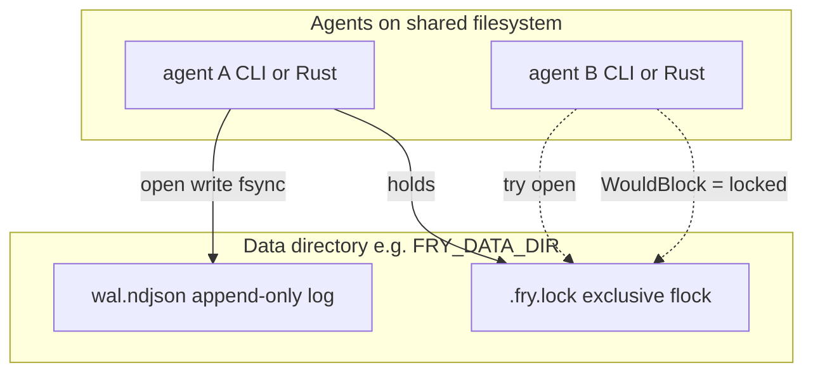

# fry architecture

fry is an **embedded** store: no TCP port, no background daemon. A process **opens** a data directory, holds an exclusive lock for its lifetime, then **closes** when the process exits or `FryDb` is dropped.

## High-level picture



## Runtime components

| Component | Role |
|-----------|------|
| **`FryDb`** | Public handle: in-memory indexes + WAL writer |
| **`KvStore`** | `BTreeMap<(namespace, key), Vec<u8>>` — current KV snapshot |
| **`InboxIndex`** | Messages by UUID + per-recipient lists + ack set |
| **`Wal`** | Appends one JSON line per mutation; `fsync` after each append |
| **`.fry.lock`** | Advisory exclusive lock (via `fs2`); one writer process per directory |

## Open sequence (every start)

1. `create_dir_all` on the data path.
2. Open `.fry.lock` and `try_lock_exclusive()`.
3. **Replay** entire `wal.ndjson` into `KvStore` and `InboxIndex` (in order).
4. Open `wal.ndjson` for append.

There is no separate snapshot file in v0.1 — the WAL **is** the source of truth; memory is a cache rebuilt on every open.

## Write path

Every mutating API (`put`, `delete`, `inbox_send`, `inbox_ack`):

1. Build a `WalRecord` (see [SPEC.md](SPEC.md)).
2. Append one line to `wal.ndjson`.
3. `flush` + `sync_data()` on the WAL file.
4. Apply the same record to in-memory structures.

Reads (`get`, `scan_prefix`, `inbox_list`) hit memory only; no WAL read.

## Consistency and durability

| Property | Behavior |
|----------|----------|
| **Durability** | Each write is flushed and `fsync`’d before returning success |
| **Atomicity** | One record = one WAL line; replay is all-or-nothing per line parse |
| **Isolation** | Single writer; second opener gets `FryError::Locked` |
| **Crash recovery** | On reopen, replay all well-formed lines; corrupt line → `FryError::CorruptWal` |

## Inbox routing

- Message stored with `to` = recipient agent id or `"*"`.
- `inbox_list(agent, unread_only)` returns messages where `to == agent` **or** `to == "*"`.
- `inbox_ack(agent, id)` appends an ack record; message stays in the log but is marked read in memory.
- Broadcast does not fan out to per-agent keys in the KV — only inbox indexes.

## What fry is not

- Not replicated, not networked.
- Not SQL; namespaces are convention only.
- No MVCC — readers in another process cannot open while the writer holds the lock.
- No WAL compaction yet — deleted keys and acks remain in the log (disk grows).

## Module layout (Rust)

```
fry/
  src/lib.rs      FryDb API, open/replay/apply
  src/wal.rs      wal.ndjson I/O
  src/record.rs   WalRecord JSON schema
  src/inbox.rs    InboxIndex
  src/error.rs    FryError
  src/bin/fry.rs  CLI
```